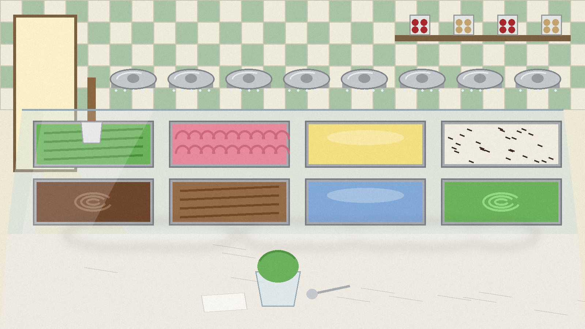
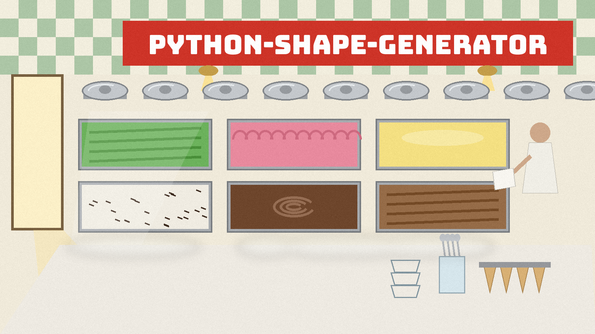
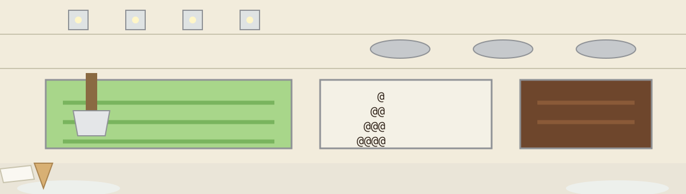

# Python-Shape-Generator





Run `python3 python-shape-gen.py`, pick one of the five shapes by its
exact name (Square, Rectangle, Lower Left Triangle, Upper Left Triangle,
Diamond), then give it a size. Rectangle asks for a width and a height;
the others ask for one side length or radius.

The script opens with `Welcome to the shape maker!` and prints its list
with brackets and quotes, just as Python prints a list:

```
['Square', 'Rectangle', 'Lower Left Triangle', 'Upper Left Triangle', 'Diamond']
```

> **Tasting note, propped against the glass:** the exact name warning. Type one of the five names exactly, capitals and spaces included. A name that is not on the list earns the reply below, word for word, and another try.

```
Invalid choice please enter correctly
```


## The five pans, in list order

### Square

One prompt, Side length. Rows of the at sign, as many across as down:

```
@@@
@@@
@@@
```

### Rectangle

Two prompts, Width then Height, the only shape that asks two questions. An earlier version picked the height at random; the current script asks for both numbers, because a rectangle needs both:

```
@@@@
@@@@
```



### Lower Left Triangle

One prompt, Side length. Rows growing by one mark each time, starting from a single at sign:

```
@
@@
@@@
@@@@
```

### Upper Left Triangle

One prompt, Side length. The same row count shrinking instead, full width first, one mark last:

```
@@@@
@@@
@@
@
```


### Diamond

One prompt, Radius. The only shape drawn in hash marks instead of at signs, and the only one announced before it appears:

```
Creating Diamond
  #
 ###
#####
 ###
  #
```

Each row holds an odd count of marks, one, three, five, and the spaces in front do the centering. The widest row prints once.


## Sizes and refusals

Sizes are read by `read_size()`, which asks again instead of failing:

> **Tasting note:** the two size refusal messages, quoted word for word. A size typed as letters or as a fraction earns `Please enter a whole number.`. Zero or below earns `Please enter 1 or more.`.

Closing the input at any prompt ends the program quietly, with no error shown. If the width of a Rectangle comes back as a quit, the script stops there and does not ask for a height.

## Importing the draw functions

Each shape has its own draw function, and all of the asking happens in `main()` and in `read_size()`, so the file can be imported and a draw function called on its own, for instance `draw_diamond(3)`, without the welcome text and prompts getting in the way. Importing the file runs nothing.

## Files

- `python-shape-gen.py`: the whole program.
- `logo.png`, `banner.png`, `intro-banner.png`: generated branding for this repo.
- `LICENSE`: license file.
